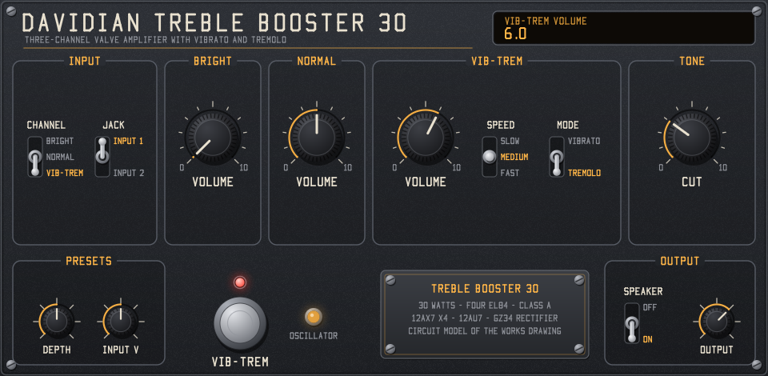

# Davidian Treble Booster 30

A circuit-level model of a British three-channel, 30-watt valve amplifier, as LV2, VST3 and Audio Unit plugins for
Windows, macOS and Linux. It is solved from the manufacturer's works drawing, with its listed modifications,
component for component: three input channels on ECC83s, a 12AU7 vibrato modulator driven by a phase-shift
oscillator, the Cut control, four cathode-biased EL84s in class A, a valve rectifier that sags, and the output
transformer into a reactive speaker load.

Plugin URI: `urn:davidian:treble-30`. Made with AI assistance; see [Use of AI](#use-of-ai).



## Controls

| Panel | What it is on the drawing |
|---|---|
| **Input: Channel, Jack** | Which jack the guitar is plugged into: Bright (J1/J2), Normal (J3/J4) or Vib-Trem (J5/J6), Input 1 or Input 2. Input 1 feeds the grid through both 68K resistors; Input 2 through one, with the other to ground (6 dB less). Only one jack is used at a time. |
| **Bright: Volume** | VR2, 500K log. The Bright channel reaches it only through C3 (500 pF), loaded by R74 (150K), so it is very thin on its own: its bass rolls off from about 2.8 kHz. That is what the drawing shows. |
| **Normal: Volume** | VR1, 500K log, fed through C2 (0.05 µF). Both channels share V1's cathode resistor, so a little of each bleeds into the other. |
| **Vib-Trem: Volume** | VR4, 500K log, after the vibrato modulator and its four-section high-pass. This channel goes to the other grid of the phase splitter. |
| **Vib-Trem: Speed** | SW1: Slow, Medium, Fast (R65 1M, R64 560K, R63 330K in the oscillator's phase-shift ladder). The model runs at about 5.9, 7.0 and 8.4 Hz. |
| **Vib-Trem: Mode** | SW3 with C38: Vibrato, or Tremolo (one side of the modulator shorted). |
| **Tone: Cut** | VR3 (250K log) with C10 between the output valves' grids. Turning it up takes the top off. |
| **Presets: Depth** | VR5, the internal depth preset (500K log with R73). |
| **Vib-Trem footswitch** | SW2. Off stops the oscillator. The amber lamp beside it follows the oscillator. |
| **Presets: Input V** | Not on the drawing: the volts at the input jack that a full-scale sample stands for (default 1 V). |
| **Output: Speaker** | Not on the drawing: On adds the acoustic response of an open-back 2x12 combo with a close microphone. Off gives the voltage at the speaker terminals, with the speakers' electrical load still in the circuit. |
| **Output: Level** | Not on the drawing: output trim. 0 dB puts 30 V at the speaker terminals (about the rated power) at full scale. |

The host's bypass crossfades to the dry signal in 20 ms, delayed to match the plugin's latency.

## How close it is to the drawing

**From the drawing:** every resistor, capacitor, pot, switch and valve in the signal path, the oscillator and the power
supply filter, and how they are wired. The model solves each section as a nonlinear circuit (valve equations, Newton
iteration, trapezoidal capacitors and inductors) at about 96 kHz inside.

**Estimated, because the drawing does not give them** (each is marked "est." in `src/dsp/amp.cpp`):

- Valve curves: Koren's published fits for the ECC83 and 12AU7, and an EL84 fit set to the datasheet's 48 mA point.
- Rectifier and mains transformer: a 390 V source behind 330 Ω, which idles the output stage near 337 V with 12.4 V on
  the cathode resistor (about 39 mA and 11.6 W a valve, so class A as built). The 100 Hz ripple is left out.
- Choke: 15 H (the drawing says 10–20 H), 150 Ω.
- Output transformer: 4 kΩ anode to anode to the 15 Ω tap (the figure collectors give for this amplifier), with
  magnetising and leakage inductance set for an 18 Hz to 16 kHz band.
- Speakers: a 15 Ω load with voice-coil inductance and an 85 Hz cone resonance.

**Read with interpretation:** the drawing is a hand-traced works copy, and some crossings are hard to tell from joins.
These were settled by tracing each wire to both ends and checking that the result works as a circuit:

- The two halves of V1 have separate anodes (Bright to C3, Normal to C2) and share the cathode resistor.
- VR1's cold end and R74 return to ground.
- The vibrato: V7b is a split-load stage; two compensated dividers across its cathode load (R54–R57, C22–C25),
  each with an anti-phase feed from its anode (C26/R58, C27/R59), drive V8's two grids through C20 and C21. V8's anodes
  share R41/C41 and R40, and its output goes through the C12–C15 high-pass to VR4.
- The oscillator: V9a is a three-section phase-shift oscillator; V9b is a split-load stage whose anode (C34) and
  cathode (C37) drive V8's grid returns in anti-phase. The depth preset is a divider against R69 at V9b's input.
- SW1 is taken as a three-position switch, and SW2 as shorting the oscillator's ladder.

**Left out:** the mains voltage selector, the heaters and the mains switch, which do not affect the sound.

Measured from the model (`test_dsp`): 31.5 W into 15 Ω flat out with 21 V of supply sag; Cut at 10 takes 18.5 dB off at
5 kHz; vibrato swings the pitch by about 43 cents with 4.6 dB of level change, tremolo swings the level by 38 dB.

## Install

Ready-built zips for each system come from the GitHub Actions builds (and Releases, when a version is tagged):

| File | For | Contains |
|---|---|---|
| `...-windows-x64.zip` | 64-bit Windows 10 and 11 | VST3 and LV2 |
| `...-macos-universal.zip` | macOS 10.13 and later, Apple silicon and Intel | Audio Unit, VST3 and LV2 |
| `...-linux-x64.zip` | 64-bit Linux on x86: LV2 needs glibc 2.29 or later (Ubuntu 20.04, Debian 11), VST3 glibc 2.34 (Ubuntu 22.04, Debian 12) | VST3 and LV2 |
| `...-linux-arm64.zip` | 64-bit Linux on ARM, with the same glibc needs | VST3 and LV2 |

Close your host, then copy the format it uses:

- **VST3:** `Davidian Treble Booster 30.vst3` into `C:\Program Files\Common Files\VST3` (Windows),
  `~/Library/Audio/Plug-Ins/VST3` (macOS) or `~/.vst3` (Linux).
- **Audio Unit (macOS):** `Davidian Treble Booster 30.component` into `~/Library/Audio/Plug-Ins/Components`.
- **LV2:** the `treble30.lv2` folder into `%APPDATA%\LV2` (Windows), `~/Library/Audio/Plug-Ins/LV2` (macOS) or `~/.lv2`
  (Linux).

The macOS builds are not notarised, so clear the download quarantine once in Terminal, for example:

```bash
xattr -dr com.apple.quarantine ~/Library/Audio/Plug-Ins/Components/"Davidian Treble Booster 30.component"
```

Restart the host or rescan, and look for **Treble Booster 30** by **Davidian**. The plugin is mono: a stereo input is
mixed to mono, and the output goes to every output channel.

## Build and test

**Every format (CMake 3.25 or later, a C/C++ compiler; Linux also needs the X11 development files):**

```bash
cmake -S . -B build-cmake -DCMAKE_BUILD_TYPE=Release
```

```bash
cmake --build build-cmake --config Release
```

```bash
ctest --test-dir build-cmake -C Release --output-on-failure
```

The VST3 SDK (and on macOS, Apple's AudioUnitSDK) is downloaded while configuring. The outputs land in
`build-cmake/treble30.lv2`, `build-cmake/VST3/Release/` and, on macOS, `build-cmake/AU/`. Steinberg's validator runs on the
VST3 after each build. Turn formats off with `-DTB_VST3=OFF` or `-DTB_AU=OFF`.

**Windows, LV2 only, without CMake:** run `build.bat` (Visual Studio 2017 or later with the C++ tools). It builds
`build\treble30.lv2` and the test programs in `build-test`:

```bash
build-test/test_dsp.exe build/treble30.lv2
```

```bash
build-test/ui_check.exe build/treble30.lv2
```

```bash
build-test/lilv_check.exe build
```

`lilv_check` uses the lilv library from an Ardour 9 install.

**Tests:** `test_dsp` (circuit and plugin), `params_check` (the VST3/AU parameter table against the LV2 metadata and the
panel), `ui_render` (draws the panel to a .bmp), `ui_check` (drives the Windows GUI with mouse messages),
`vst3_check` (hosts the VST3, drives its editor and compares its sound with the LV2 build) and `au_check` (the same for
the Audio Unit on macOS).

**Cost:** about 19% of one core at 48 kHz with a guitar-level signal, about 28% with the Vib-Trem channel in use (the
vibrato section is skipped while its volume is at 0), measured on the development machine.

## Use of AI

This plugin was made with generative AI (Claude Code). [AI_USAGE.md](AI_USAGE.md) says what the AI did and how its work
was checked.

## Licence

GPL-3.0-or-later; see [LICENSE](LICENSE). Third-party parts and sources are listed in [NOTICE.md](NOTICE.md).
VST is a registered trademark of Steinberg Media Technologies GmbH. Audio Units and macOS are trademarks of Apple Inc.
